# WealthGenie — Financial Literacy Platform for Indian Beginners

A clean, trustworthy financial-education and personal-finance web app that helps Indian beginners learn money management in plain language, without jargon, speculation or high-risk claims. Every number shown to a user is either a deterministic calculation the user can inspect, or data from a named public source with recorded provenance — never invented.

> **Status:** educational prototype. It is **not** a SEBI-registered Investment Adviser, is not production-hardened, and has no real-user deployment. See [Regulatory disclaimer](#regulatory-disclaimer) and [Limitations](#10-data-sources-assumptions-limitations-privacysecurity-future-work).

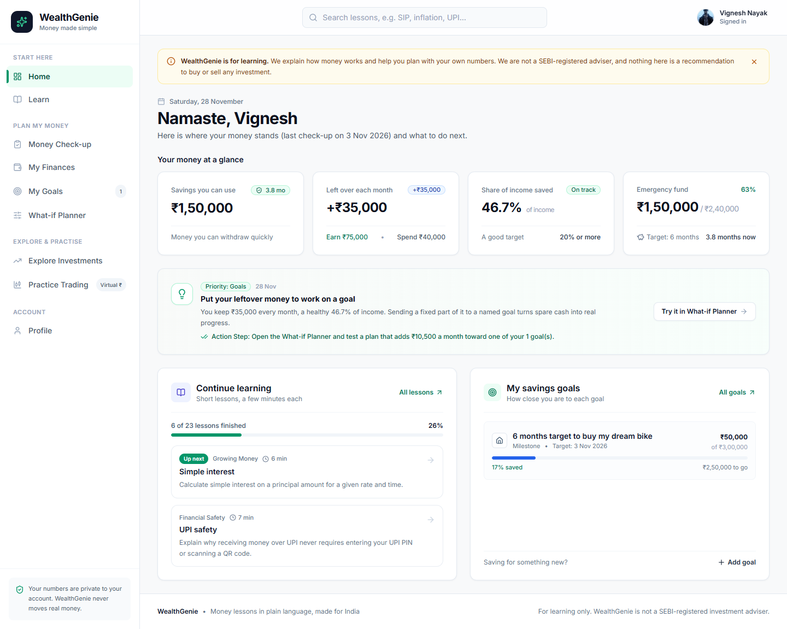

---

## Contents

1. [Project overview](#1-project-overview--the-problem-it-addresses)
2. [Who it is for](#2-who-it-is-for)
3. [Features and user flow](#3-what-the-project-does--features-and-user-flow)
4. [Screenshots](#4-screenshots)
5. [Engineering solution](#5-engineering-solution)
6. [Measured results](#6-measured-results)
7. [Business impact](#7-business-impact)
8. [What improved compared with the prior approach](#8-what-improved-compared-with-the-prior-approach)
9. [Install, configure, run and test](#9-how-to-install-configure-run-and-test)
10. [Data sources, assumptions, limitations, privacy/security, future work](#10-data-sources-assumptions-limitations-privacysecurity-future-work)

---

## 1. Project overview — the problem it addresses

First-time investors in India face three compounding problems:

1. **Jargon-heavy, sales-driven information.** Most accessible content is aimed at selling products, not building understanding.
2. **Fabricated "AI" and fake market data in tools.** Many demos plot invented charts or simulate an assistant with keyword matching, which is actively dangerous for a beginner who cannot tell the difference.
3. **No safe place to practise.** Beginners either read theory with nothing to try, or jump straight into real money.

WealthGenie addresses all three by combining a structured curriculum with quizzes, a money check-up, verified public market data, deterministic calculators, a what-if planner and a virtual-money trading sandbox — with every metric and suggestion explained in plain language.

## 2. Who it is for

- **Primary user:** Indian beginners (students and first-jobbers) who want to learn budgeting, saving and investing basics in rupee terms before risking money.
- **Business need the project addresses:** a trustworthy, low-risk financial-education funnel (Learn → Check-up → Plan → Explore → Practise) that could be embedded by student communities, fintech onboarding flows or campus programmes. *This is the intended positioning; no market validation has been done (see section 7).*
- **Secondary audience:** reviewers and evaluators — this is also a university research project with reproducible evaluation harnesses (`experiments/`, `evaluation/`) and an IEEE-format paper draft in `paper/`.

## 3. What the project does — features and user flow

The frontend is a React SPA (`frontend/src/pages/`). After signing in, the sidebar groups the app by what a beginner is trying to do:

| Section | Page | What the user can do |
|---|---|---|
| Start here | **Home** (`HomePage.jsx`) | See their money at a glance (usable savings, monthly surplus, savings rate, emergency-fund progress), one prioritised next step, the next lessons to take and goal progress. |
| | **Learn** (`LearnPage.jsx`) | Follow a 23-lesson roadmap in five branches (Money Basics, Saving, Growing Money, Investing, Financial Safety). Lessons unlock only when the earlier ones are finished; each has learning outcomes, a plain-language explanation, worked examples, a quick-check quiz and cited official sources. |
| Plan my money | **Money Check-up** (`AssessmentPage.jsx`) | Enter income, spending, savings and a goal; get computed surplus, savings rate, emergency coverage and a goal projection, each with the formula and assumptions shown. Check-ups are saved to the account. |
| | **My Finances** (`MyFinancesPage.jsx`) | A simple picture of cash flow built from the latest check-up, plus saved goals and past check-ups. |
| | **My Goals** (`GoalsPage.jsx`) | Create, edit and track savings goals by category (Security, Milestone, Retirement, Lifestyle, Other). |
| | **What-if Planner** (`DigitalTwinPage.jsx`) | Try changes (a pay rise, a new EMI, a one-time expense) against the user's real numbers and see a metric-by-metric baseline vs scenario comparison with "why this metric" explanations. The real numbers are never changed. |
| Explore & practise | **Explore Investments** (`ExploreInvestmentsPage.jsx`) | Three tabs: **Planner** (how a monthly SIP could grow, with alternative returns and downside scenarios), **Guide** (deterministic readiness checks and transparently scored investment categories backed by the verified AMFI/SEBI fund dataset) and **Historical** (Nifty 50 TRI and AMFI NAV back-tests and a historical SIP simulator using verified data only). |
| | **Practice Trading** (`PaperTradingPage.jsx`) | Buy and sell with ₹1,00,000 of virtual money in a private, per-user portfolio. Three markets: a **practice market** of made-up companies that ticks every second (always open), the **real market** (live NSE prices during market hours) and **replay the past** (step through real historical prices one day at a time). Simple and advanced views, candlestick chart and order history. |
| Account | **Profile** (`ProfilePage.jsx`) | Manage the account profile. |

**Typical user flow:** sign in (Supabase auth) → Learn and pass quizzes (progress syncs to the account, with a browser fallback) → run the Money Check-up → set goals → rehearse decisions in the What-if Planner → explore investments → practise in Practice Trading.

Lesson content, quizzes and citations live in versioned files under `content/learning/v1/`, served by `GET /api/learn/lessons/:conceptId`. Reading lessons never requires an AI key; Gemini is only an optional fallback lesson generator (`POST /api/learn/lesson`) and the app reports an honest "not configured" state without it. There is no chatbot.

## 4. Screenshots

All screenshots were captured from the running app (desktop, 1440 px wide) and live in [`docs/screenshots/`](docs/screenshots/).

### Sign in
Unauthenticated visitors only see the sign-in / sign-up screen.

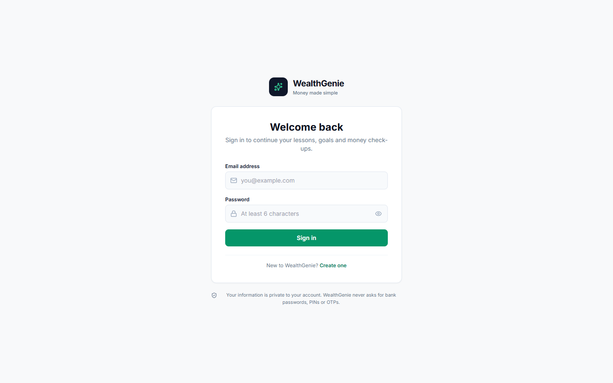

### Learn — roadmap
Lessons are grouped into five branches; finished, ready and locked lessons are clearly marked, with the prerequisite shown on each locked card.

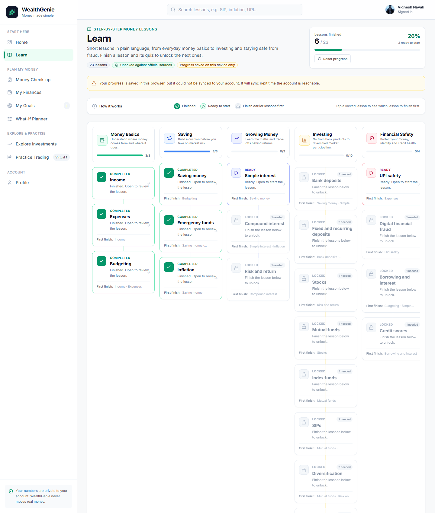

### Learn — lesson and quiz
Each lesson shows its source-review status, learning outcomes, explanation and worked examples, followed by a quick-check quiz that must be answered correctly to complete the lesson.

| Lesson | Quick-check quiz |
|---|---|
| 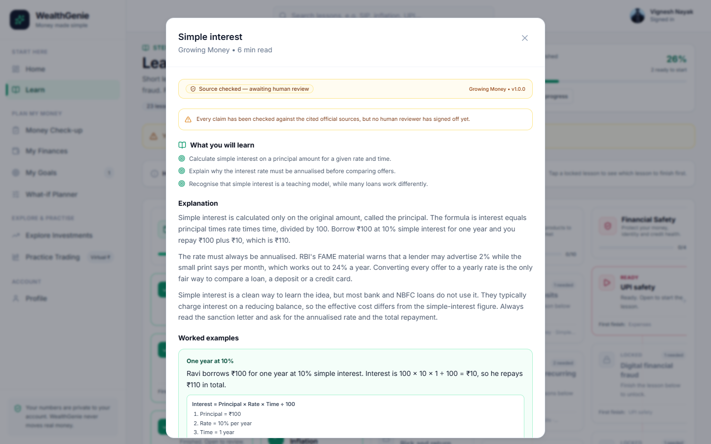 | 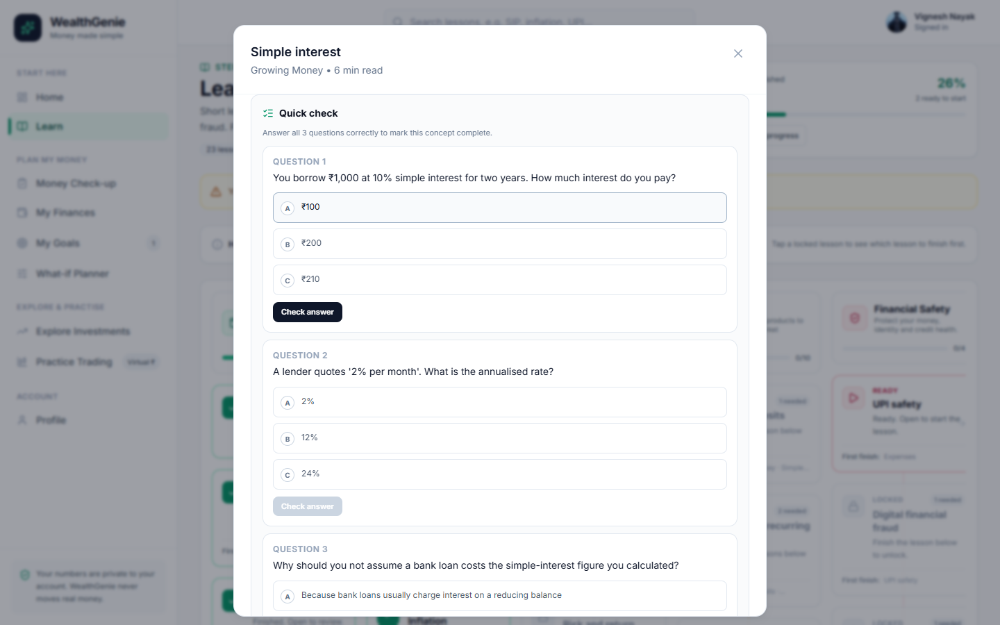 |

### Money Check-up
Monthly numbers in, computed metrics, goal projection, recommendations and the assumptions behind them out.

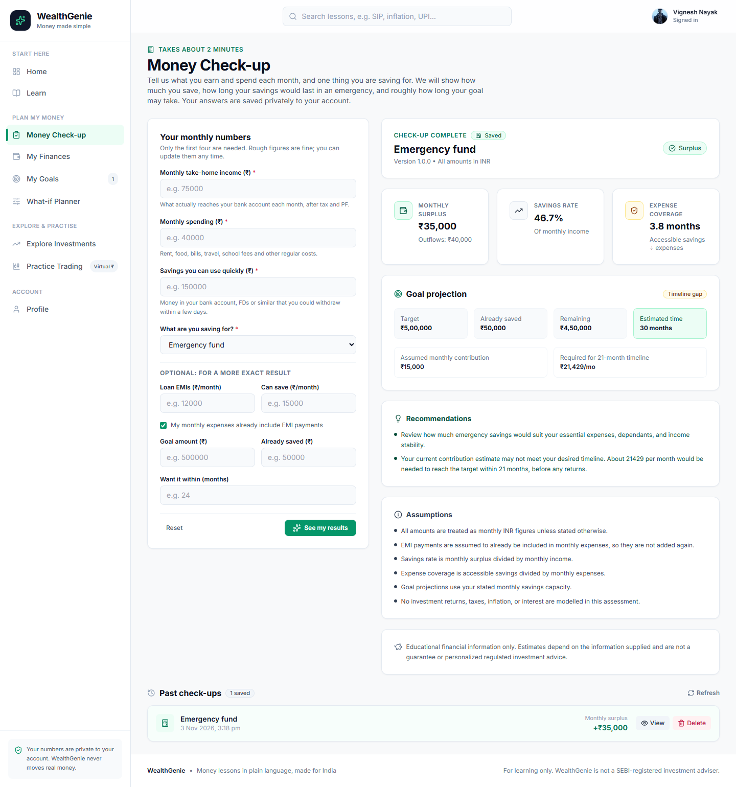

### My Finances and My Goals

| My Finances | My Goals |
|---|---|
| 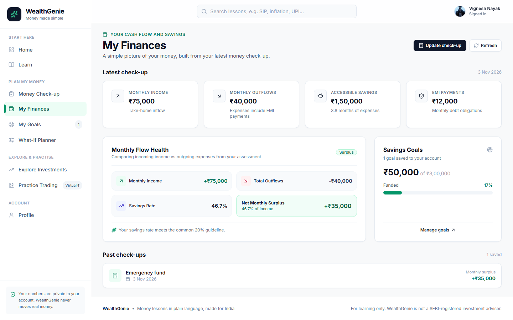 | 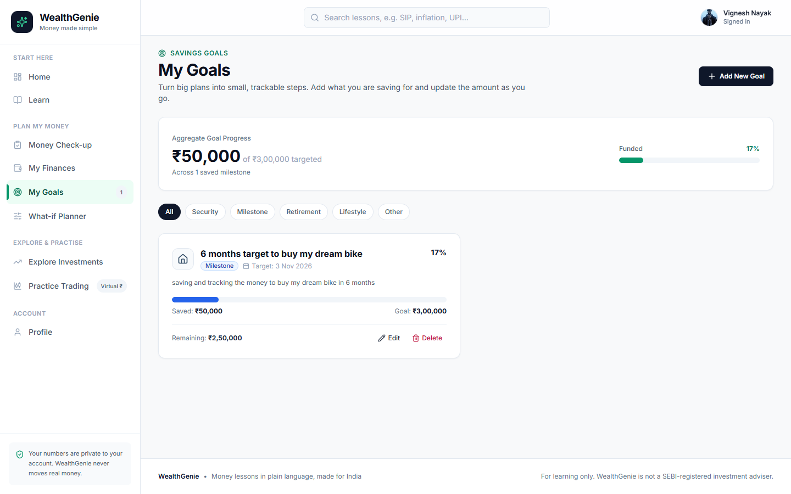 |

### What-if Planner
A scenario (income ₹75,000 → ₹90,000, EMI ₹12,000 → ₹20,000, a ₹60,000 one-time expense) compared metric by metric against the baseline.

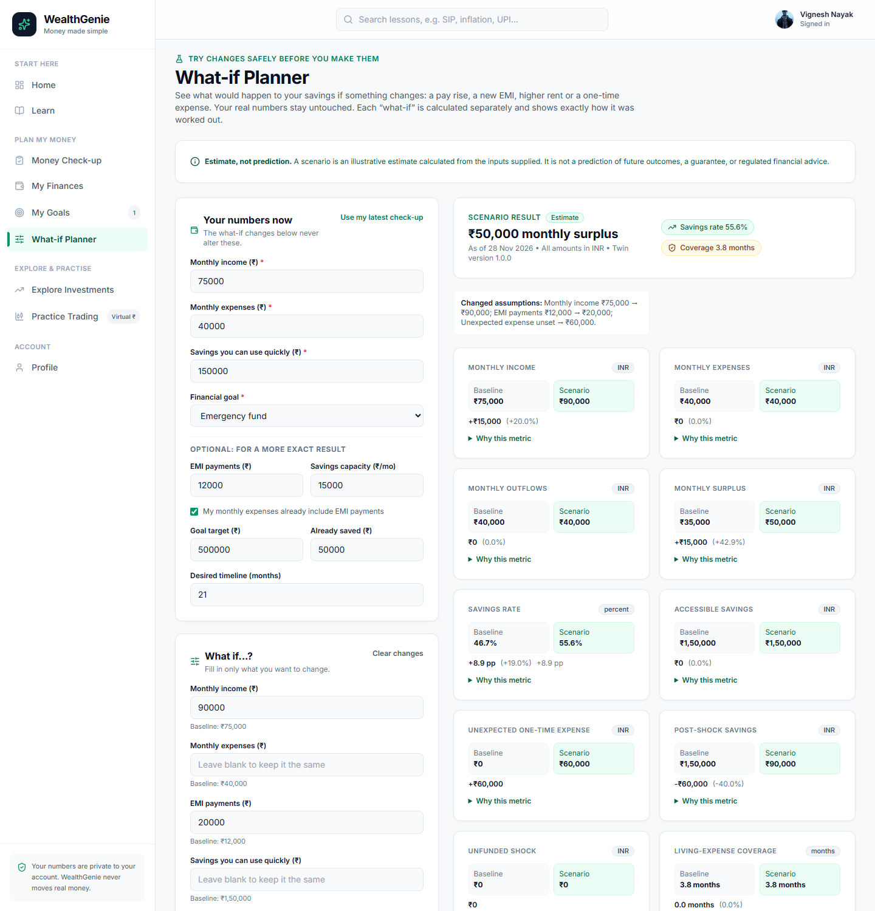

### Explore Investments — Planner
A hypothetical SIP projection driven by the user's own check-up, with alternative return assumptions, goal-funding comparison and downside scenarios.

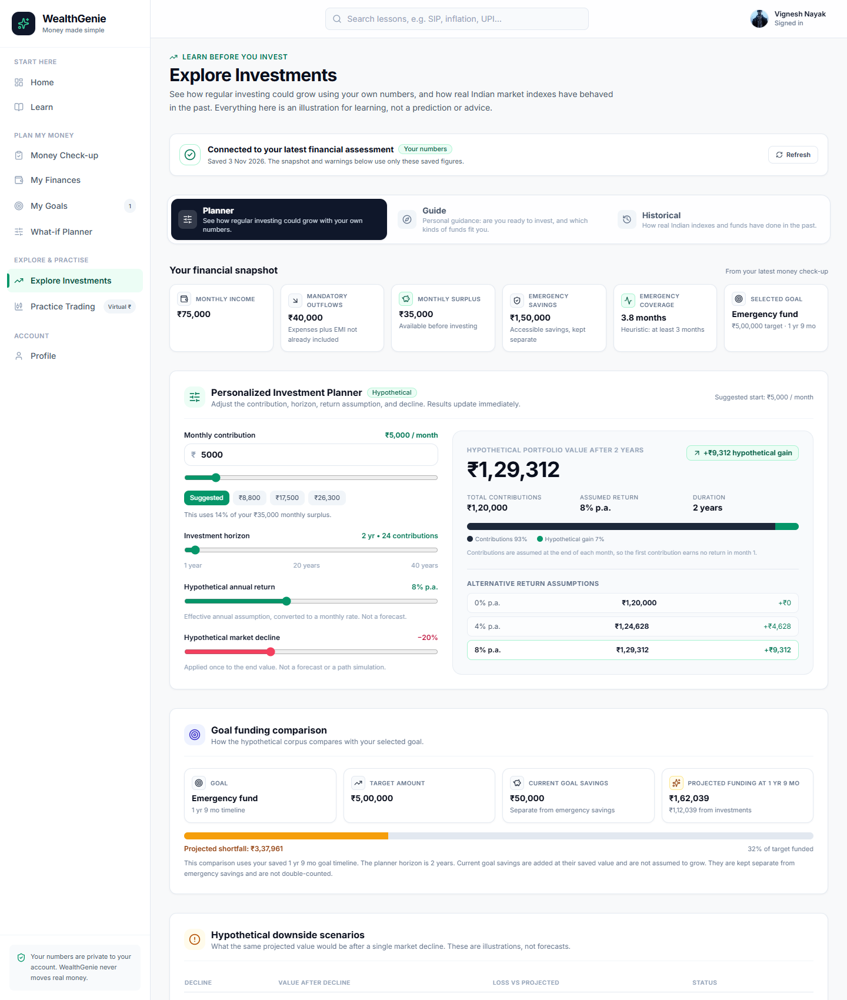

### Explore Investments — Guide
Deterministic readiness metrics and investment categories ranked by a transparent, per-factor score (horizon, risk, liquidity and goal fit), with caveats for each category.

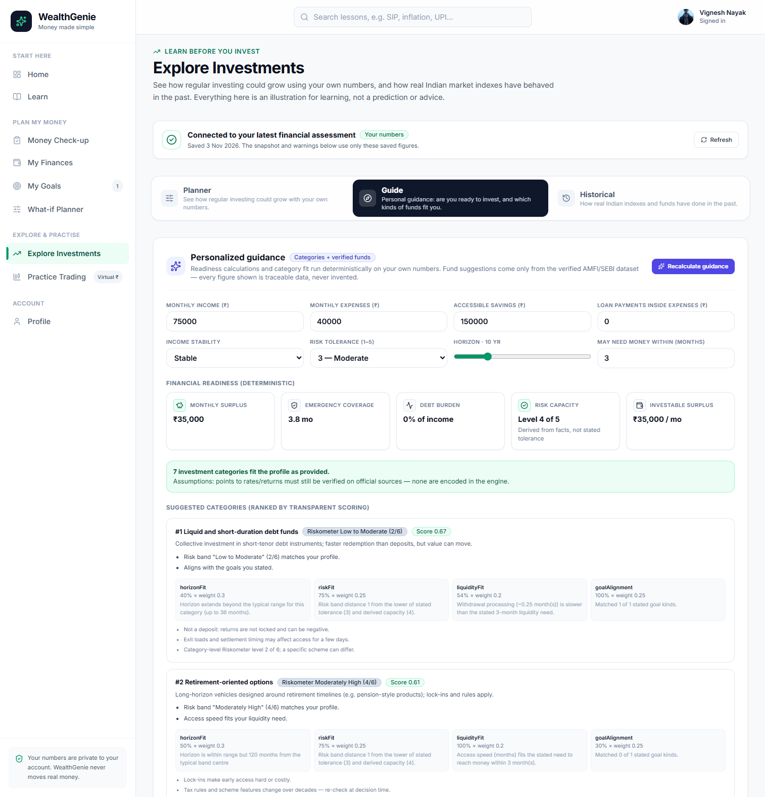

### Explore Investments — Historical
Back-tests on the verified Nifty 50 TRI series (2010–2026) and AMFI NAVs, plus a historical SIP simulator.

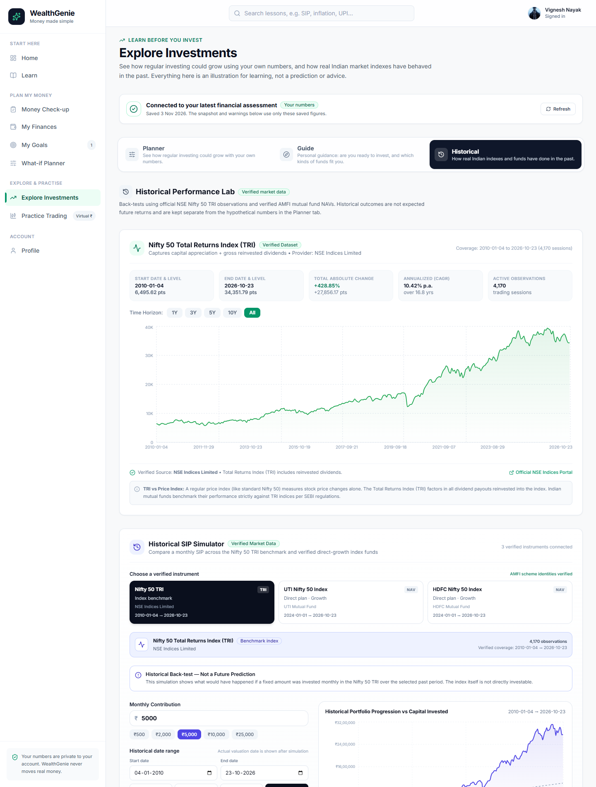

### Practice Trading
Virtual ₹1,00,000 portfolio, practice / real / replay market switch, live-ticking practice instruments, buy/sell form and a candlestick chart.

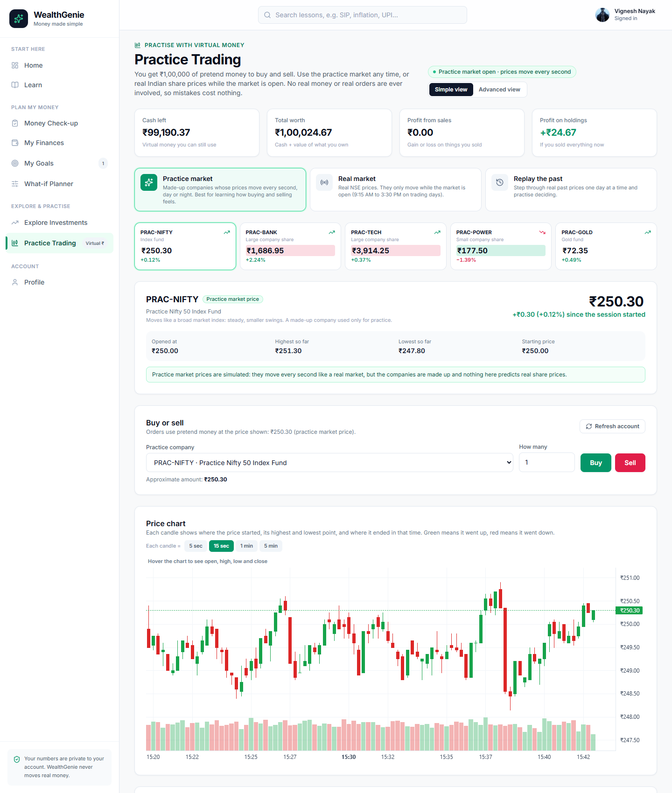

## 5. Engineering solution

### Architecture

Single monorepo; no microservices.

```
wealthgenie/
├── frontend/          # React 18, Vite, Tailwind CSS; pages, formatters, charts
├── backend/           # Express REST API + WebSocket market feed; deterministic finance utils
│   └── src/
│       ├── routes/    # health, ai (status), calculate, investments, learn, progress,
│       │              # paper-trading, assessment, profile, assessments, goals,
│       │              # twin, scenarios, market, recommendations
│       ├── services/  # ai.service, supabase, paperTrading/* (incl. virtualMarket),
│       │              # recommendation/*, marketData/upstoxFeed.js (+ MarketDataFeedV3.proto)
│       ├── ws/        # /ws/market — live, practice and replay ticks
│       └── utils/     # financialMath, financialAssessment, financialTwin,
│                      # learningProgress, lessonSchema, databaseErrors
├── ai/                # lesson prompt and safety guardrails (ai/safety/guardrails.json)
├── content/           # Versioned lesson content (v1) + JSON schema + sources registry
├── data/              # Raw/processed datasets, provenance registry, quality reports
├── supabase/migrations/  # profiles, assessments, goals, scenarios, learning_progress
├── experiments/       # Reproducible evaluation harness (assessment engine & What-if Planner)
├── evaluation/        # Python evaluation pipeline for the report (results/, RESULTS.md)
├── ml/                # Isolated Findex research experiment (NOT used by the app)
├── wealthgenie-datasets/  # Python dataset pipelines (merge, NAV metrics, holdings)
├── scripts/           # Import/validation/evaluation utilities
├── paper/             # IEEE paper draft (LaTeX)
├── docs/              # Architecture, API contracts, protocols, audits, screenshots/
└── tests/             # node:test files (unit + integration)
```

### Key technologies

| Layer | Technology | Why |
|---|---|---|
| Frontend | React 18, Vite, Tailwind, Recharts, lightweight-charts | Fast SPA with lazily loaded pages; charts render only verified datasets |
| Backend | Node.js + Express (ESM), `ws` | Lightweight REST; every calculation server-side and testable; WebSocket price ticks |
| Auth & persistence | Supabase (Postgres) + row-level security | Per-user progress, check-ups, goals, scenarios; `user_id` always from the verified token |
| AI | Google Gemini via `GEMINI_API_KEY` (optional) | Fallback lesson generation only; honest unconfigured state when absent |
| Market data | NSE Indices (Nifty 50 TRI), AMFI NAV, optional Upstox websocket feed (`upstox-js-sdk`) | Verified history with checksums; live feed for the real market in Practice Trading |
| Research | Python dataset/evaluation pipelines; seeded Node experiment harness | Reproducibility without runtime dependencies |

### Data flow

```
Public sources (NSE Indices, AMFI, banks' pages, SEBI/RBI links)
        │  import scripts + checksums
        ▼
data/raw/  →  data/processed/*.csv|json  →  backend dataset loaders
        ▼                                   (verified fund data, historical charts)
User inputs ──▶ Express API ──▶ deterministic utils (SIP, compound growth,
                │                What-if Planner, recommendation rules)
                │                     │
                ├─▶ Gemini (optional lesson fallback) ──▶ honest unconfigured state
                ├─▶ Practice market / Upstox / replay ──▶ /ws/market ticks
                └─▶ Supabase (auth + user-scoped tables with RLS)
                          │
                          ▼
        React UI (en-IN ₹ formatting enforced in frontend/src/utils/formatters.js)
```

### Important design choices

1. **No fake AI and no fake market data.** There is no chatbot; the optional Gemini lesson fallback reports an honest unconfigured state when no `GEMINI_API_KEY` exists. Explore Investments charts use only verified Nifty 50 TRI / AMFI NAV data with provenance in `data/sources/sources.json` (retrieval dates, checksums, coverage). The practice market uses clearly labelled, made-up `PRAC-*` companies so it can never be mistaken for real prices.
2. **Determinism over ML.** Recommendations are rule-based and explainable, with a per-factor score breakdown shown to the user. A collaborative-filtering/ML recommender was deliberately **not** deployed because the repo holds no verified user–fund interaction dataset (`data/reports/evaluation_report.md`, "Documented limitations").
3. **Calculations are labelled as projections, never predictions.** The What-if Planner and the investment Planner always mark output as an estimate (`docs/DIGITAL_TWIN.md`).
4. **Provenance is mandatory.** Raw and processed data are separated; every registry entry carries provider, coverage, access rules and SHA-256 checksums.
5. **User-scoped data with RLS.** Migrations in `supabase/migrations/`; ownership enforced in `backend/src/middleware/auth.js` and every route (covered by `tests/ownershipRoutes.test.js`, `tests/protectedRoutes.test.js`). Paper-trading accounts are per user.
6. **Plain language for beginners.** Navigation and copy avoid developer/analyst jargon (e.g. "Money Check-up", "What-if Planner", "Practice Trading").
7. **Measured, reproducible evaluation.** `npm run experiment` regenerates a full report from a fixed seed; `docs/RESEARCH_EVALUATION.md` is a generated artifact.
8. **ml/ is isolated.** The Global Findex classifier experiment (`ml/train.py`) is survey-response research preserved for auditability; it is not imported by any production code path (`ml/README.md`).

## 6. Measured results

All numbers below come from executable or recorded evidence in this repository. Three evidence classes are distinguished: **unit/integration tests**, **offline experiments** (synthetic data, local runs) and **production outcomes** (none — see below).

### 6.1 Unit and integration tests

| Metric | Value | Method | Source |
|---|---|---|---|
| Test suites / tests passing | **111 suites, 489 tests, 0 failures** | `node --test` run (`npm test`), re-run 2026-11-28 | `tests/*.test.js` (37 files) |
| Line test coverage | **87.68% statements / 87.68% lines / 89.89% functions / 77.2% branches** (measured 2026-11-10, before the practice-market additions); by area: `backend/src/utils` 94.85%, `services/recommendation` 95.47%, `experiments/lib` 97.9%, `frontend/src/utils` 96.04%, `services/paperTrading` 85.15%, `services/marketData` 82.45%, `routes` 76.1%, `scripts/` 48.85% | `c8` over `node --test tests/*.test.js` | `tests/*.test.js` |
| Learning-content validation | 5 branches, 23 concepts, 23 lessons, 16 sources, 0 errors, 0 warnings | `node scripts/validateLearningContent.js` | `content/learning/v1/`, `scripts/validateLearningContent.js` |

### 6.2 Offline experiment — assessment engine & What-if Planner

Synthetic seeded dataset: **226 profiles** (200 random + 26 edge cases), **1,416 scenario cases**, **1,642 evaluated results**, vs an independent reference implementation. Fixed seed `20261027`, Node v22, Windows x64.

| Metric | Value | Method | Source |
|---|---|---|---|
| Formula correctness (14 core metrics) | 22,988 / 22,988 assertions (100%) | Engine vs independent reference (`experiments/lib/reference.js`) | `experiments/results/run-20261027T170406Z-seed-20261027/run.json`; report: `docs/RESEARCH_EVALUATION.md` |
| Goal correctness (11 goal fields) | 18,062 / 18,062 (100%) | Same | Same |
| Recommendation trigger agreement | 11,494 / 11,494 decisions (100%); 1,642 / 1,642 exact-set | Same | Same |
| Scenario comparison correctness | 1,48,680 / 1,48,680 (100%) | 13 metrics × 5 comparison values × 1,416 scenarios | Same |
| Input validation | 31/31 invalid rejected with matching messages; 5/5 valid accepted | Finite adversarial suite | Same |
| Determinism | 1,642 / 1,642 repeated results identical | Re-serialization comparison (same process) | Same |
| Directional invariants | 1,172 / 1,172 applicable checks (100%); 410 N/A | Seven one-input-change rules | Same |
| Explainability coverage | 2,61,857 / 2,61,857 applicable checks (100%) | Presence of formula, inputs, reason, assumptions, heuristic labels | Same |

**What this does and does not show (from `docs/RESEARCH_EVALUATION.md` §8–9):** these rates measure *implementation consistency against a second implementation of the same spec* — not an external oracle, not real-world predictive accuracy, and not user benefit. Synthetic profiles are a deterministic test fixture, not a population sample.

### 6.3 Offline experiment — recommendation engine & dataset pipeline

Recorded executed run: `data/reports/evaluation_report.md` (generated by `scripts/evaluateRecommendations.mjs`); dataset quality: `data/reports/data_quality_report.json`. The Python evaluation pipeline for the report lives in `evaluation/` (results in `evaluation/results/`, summary in `evaluation/RESULTS.md`).

| Metric | Value | Method | Source |
|---|---|---|---|
| Recommendation API latency | cold 44–139 ms; p50 27–54 ms; p95 64–98 ms; mean 39–59 ms across 3 profiles | 12 measured requests per profile (warm catalog excluded from percentiles) | `data/reports/evaluation_report.md` |
| Recommendation constraint safety | 216 recommendations re-validated, 0 constraint violations | Post-engine re-check of all outputs | Same |
| Recommendation payload determinism | Byte-identical across repeated runs, all 3 profiles | Byte-compare of responses | Same |
| Dataset merge integrity | 38,495 rows; 11,417 matched with details; 27,078 unmatched preserved; **0 row multiplication** | Join audit in Python pipeline | `wealthgenie-datasets/`; report in `data/reports/` |
| NAV metrics coverage | 38,475 funds from 3,77,03,595 NAV observations (1Y: 29,888; 3Y: 19,968; 5Y: 7,788 funds; volatility: 34,960) | Computed from raw NAV history | `data/processed/fund_nav_metrics.csv` (+ manifest) |
| Holdings snapshot | 24 of 24 target funds name-matched, 288 snapshots | Match of AMC factsheet holdings rows | `data/processed/fund_holdings_metrics.csv` |
| Engine catalog | 8,885 active funds; 8,684 with Riskometer; 7,999 with TER; 7,769 with 1-Y history | Catalog assembly from merged dataset | Evaluation report |
| Market-data coverage | Nifty 50 TRI: 4,170 sessions, 2010-01-04 → 2026-10-23; AMFI NAV: 694 observations each for UTI (120716) and HDFC (119063) direct-growth index funds, 2024-01-01 → 2026-10-23 | Import scripts with SHA-256 checksums and retrieval dates | `data/sources/sources.json` |

### 6.4 Production outcomes

**None demonstrated.** The project has no hosted production deployment serving real users, no user counts, no engagement, no revenue and no A/B evidence. Anything beyond the tables above is **intended benefit, not measured result**.

## 7. Business impact

**Verified (from repo evidence only):**
- The trust positioning was *implemented and enforced*: zero fabricated data paths, honest AI states and full explainability coverage (§6.2) — verified by automated checks, not user opinion.
- Deterministic, reproducible behaviour is measurable and was measured (§6.2–6.3), which is a concrete engineering asset for any partner evaluating reliability.
- Content is complete and machine-validated: 23/23 concepts lesson-complete with 16 registered sources (§6.1).

**Intended but not measured (no user study, no deployment):**
- Beginner comprehension, trust and financial-literacy improvement — requires the user study designed but not executed in `docs/VALIDATION_PROTOCOL.md` (RQ7–RQ10: "Not studied").
- Business value as an education/onboarding funnel for institutions — no customer, pilot or market data exists in the repository.
- Any claim of reduced fraud susceptibility or improved saving behaviour — **not measured**; would need a longitudinal or randomised field study.

## 8. What improved compared with the prior approach

**Baseline:** the early prototype documented in `docs/walkthrough.md` — a single-folder React app with USD mock data, US-centric content and client-side keyword "AI" simulation.

| Area | Baseline (per `docs/walkthrough.md`) | Now (evidence) |
|---|---|---|
| Currency & context | USD mocks, US accounts | INR/en-IN enforced everywhere (`frontend/src/utils/formatters.js`, `tests/calculations.test.js`) |
| "AI" | Client-side keyword simulation | No chatbot; optional backend-routed Gemini lesson fallback with honest unconfigured state |
| Market data | Arbitrary mock charts/APYs | Verified Nifty/AMFI series with provenance and checksums (`data/sources/sources.json`); clearly labelled practice market |
| Practice | None | Per-user virtual-money trading with practice, real and replay markets |
| Testing | 2 test files | 37 test files (§6.1) |
| Evaluation | None | Reproducible harness, 1,642 synthetic results, published report (`experiments/`, `docs/RESEARCH_EVALUATION.md`) |

**No valid comparison exists for:** whether the check-up + What-if Planner adds decision-support value over a static assessment, or whether the platform improves user outcomes. `docs/VALIDATION_PROTOCOL.md` records RQ7 as "Not studied". A fair comparison would be a randomised or within-subject task study scored against a pre-registered rubric.

## 9. How to install, configure, run and test

### Prerequisites
- Node.js ≥ 18 (verified on v22.16.0), npm ≥ 9
- A Supabase project for auth and persistence (see `docs/SUPABASE_SETUP.md`)
- Optional: Python for dataset/evaluation pipelines (`wealthgenie-datasets/`, `evaluation/`, `ml/`); a Gemini API key for the lesson fallback; Upstox credentials for live real-market prices

### Install
```bash
npm install
npm --prefix backend install
npm --prefix frontend install
```

### Configure
```bash
cp .env.example .env                       # backend loads root .env or backend/.env
cp frontend/.env.example frontend/.env.local
```
Relevant variables (see the `.env.example` files): `PORT` (5001), `NODE_ENV`, `CORS_ORIGINS`, `SUPABASE_URL` / `SUPABASE_PUBLISHABLE_KEY`, `GEMINI_API_KEY` / `GEMINI_MODEL`, optional `UPSTOX_API_KEY` / `UPSTOX_API_SECRET` / `UPSTOX_ACCESS_TOKEN` for live prices, and on the frontend `VITE_SUPABASE_URL` / `VITE_SUPABASE_PUBLISHABLE_KEY` / `VITE_API_BASE_URL`. Apply every SQL file in `supabase/migrations/` to your Supabase project (including `learning_progress`, otherwise Learn progress stays browser-only). Restart the backend after changes.

### Run
```bash
npm run dev:backend        # watch mode → http://localhost:5001  (or start:backend)
npm run dev:frontend       # → http://localhost:5173, /api proxied to 5001
```

### Test and validate
```bash
npm test                                   # unit + integration tests
npx c8 --reporter=text node --test tests/*.test.js   # same suite with V8 coverage
npm run build:frontend                     # production build
npm run validate:content                   # lesson content & completeness gate
npm run validate:data                      # dataset quality gate
npm run import:nifty / import:amfi         # refresh verified market data
```

### Reproduce the research experiment
```bash
npm run experiment          # writes timestamped output to experiments/results/
npm run experiment:publish  # also regenerates docs/RESEARCH_EVALUATION.md
npm run experiment:verify -- experiments/results/<run>   # checksum-vs-manifest audit
```

## 10. Data sources, assumptions, limitations, privacy/security, future work

### Data sources
Registered with provenance in `data/sources/sources.json`:
- **NSE Indices** — Nifty 50 TRI daily series (4,170 sessions; non-commercial educational use).
- **AMFI** — NAV master and NAV history for UTI 120716 and HDFC 119063 direct-growth index funds; fund dataset pipelines use AMFI NAVAll/master plus AMC factsheets (`wealthgenie-datasets/`).
- **SEBI** — investor-education and Riskometer material (linked, not mirrored).
- **RBI** — banking/deposit statistics, FD rates, financial-education and DICGC insurance guidance (documented for manual collection; FD rates currently **not connected** — no rates stored).
- **Global Findex 2025 (India)** — survey microdata for the isolated `ml/` experiment only.

### Assumptions
- Deterministic finance model: constant user contributions; no investment returns, inflation, taxes, borrowing or asset sales modelled in the check-up and What-if Planner (`docs/DIGITAL_TWIN.md`, `docs/RESEARCH_EVALUATION.md` §9.4).
- Thresholds (3-month coverage, 40% EMI burden, 20% savings rate) are documented heuristics, not expert-validated values.
- Practice-market prices are simulated for made-up companies and predict nothing about real shares.

### Limitations
1. **The reference implementation is in-project** — agreement is not external validation.
2. **Synthetic, hand-designed profiles; finite one-input-at-a-time scenario suite; single platform/process determinism.**
3. **No user study** — comprehension, trust and literacy effects are unknown (`docs/VALIDATION_PROTOCOL.md`).
4. **NAV precision artifact:** liquid/overnight-fund NAV rounding can inflate volatility estimates (penalising but never rewarding a fund); documented rather than smoothed.
5. **~70% of merged rows lack a Riskometer** (legacy/inactive schemes); they are excluded and flagged, never imputed.
6. **Hosted Supabase setup must include every migration** — if the `learning_progress` table is missing, Learn shows a "saved in this browser" notice and progress does not sync to the account.
7. **Paper-trading state is stored in local JSON files** per user (`backend/src/data/paper-trading/`), not in Supabase.
8. **Coverage is uneven:** route handlers and data-import scripts are the least-covered areas; core calculation utils, the recommendation engine and experiment harness sit at 95–98%.

### Privacy & security
- Auth via Supabase; `user_id` always derived from the verified token, never the request body; all queries scoped by id **and** owner; row-level security in `supabase/migrations/`.
- Only the publishable/anon key is used client/backend-side; the service-role key must never be in `.env` (warned in `.env.example`).
- No real money or brokerage execution. The optional Upstox feed is read-only market data.
- `.gitignore` keeps secrets and raw survey microdata out of Git; the platform never asks for bank passwords, PINs or OTPs.

### Future work
1. Execute the validation protocol (expert content review; then a comprehension/trust user study per `docs/VALIDATION_PROTOCOL.md`).
2. Move paper-trading persistence to Supabase; complete hosted-Supabase verification; raise coverage in `backend/src/routes` and `scripts/`.
3. A/B-style comparison of static check-up vs check-up + What-if Planner (RQ7 in `docs/VALIDATION_PROTOCOL.md`).
4. For an ML recommender (see `ml/`): only with a verified user–fund interaction dataset, and after mapping survey features to collected inputs — the repo currently provides neither.

## Regulatory disclaimer

WealthGenie is an educational financial-literacy prototype for Indian beginners. It is not a SEBI-registered Investment Adviser (RIA), research analyst or portfolio manager. All content is for educational literacy only; calculations are mathematical projections based on user inputs, not guarantees. Data providers' terms apply (see `data/sources/sources.json`).
