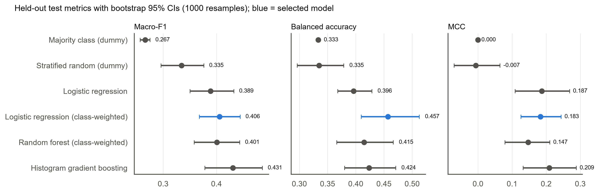
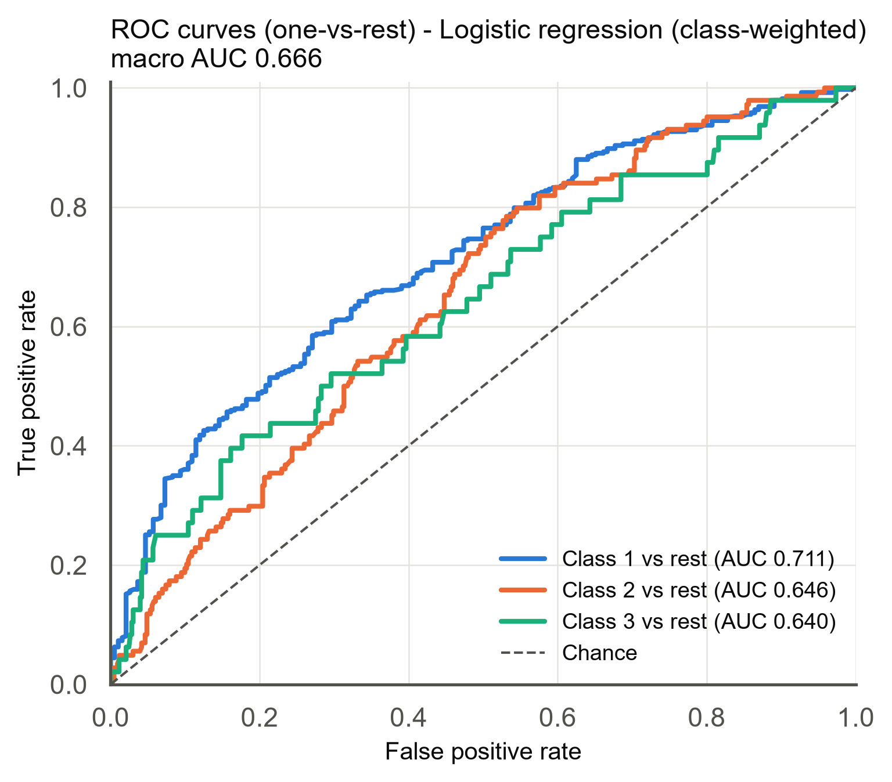
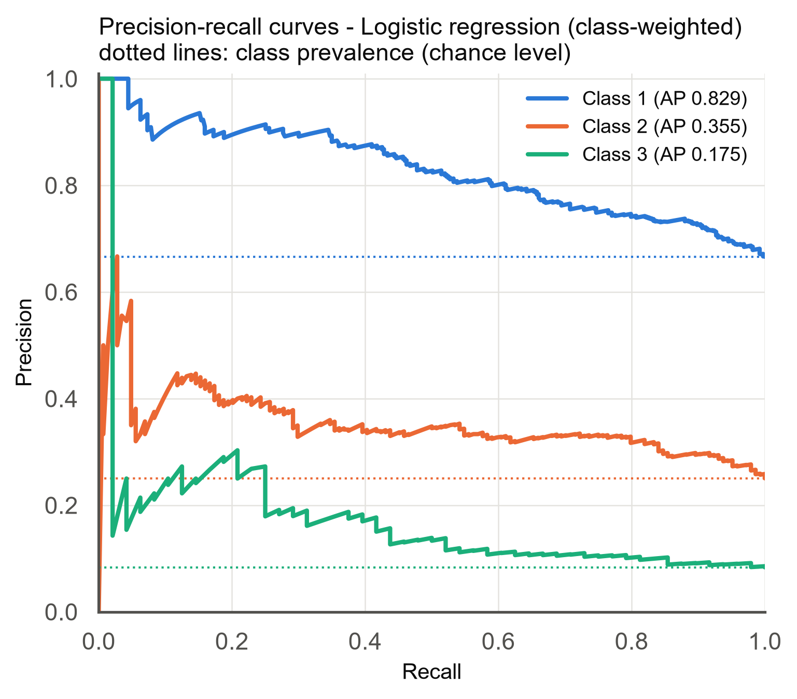
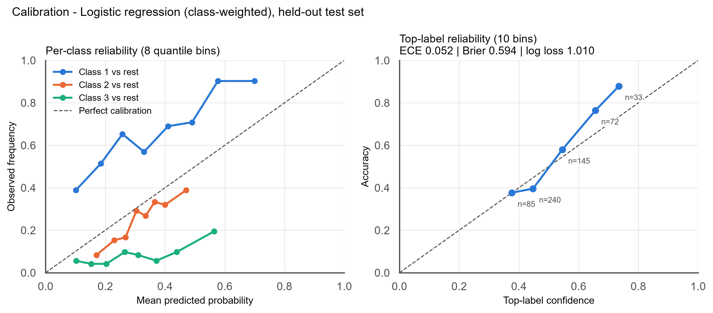
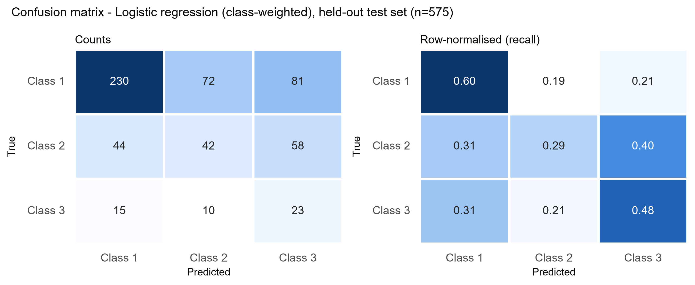
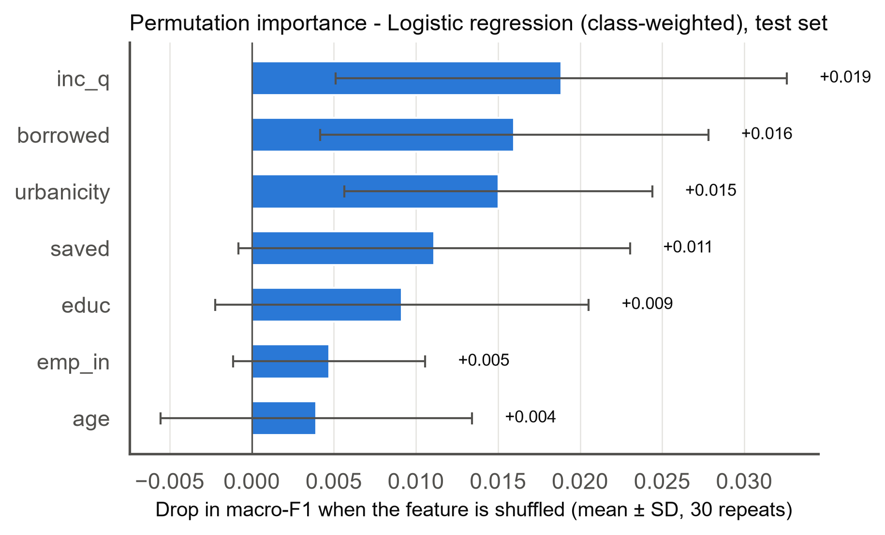
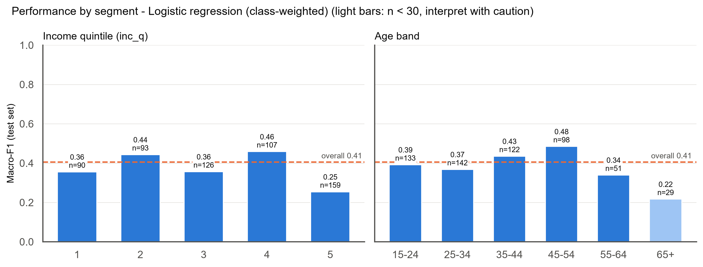
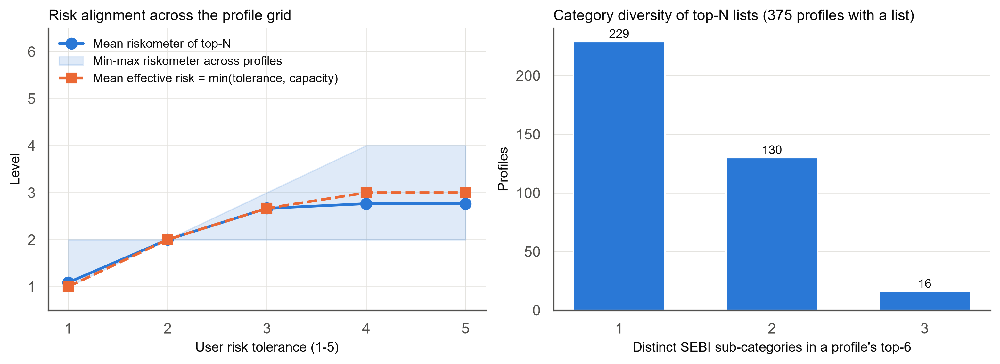

# WealthGenie — Evaluation Results

Generated 2026-11-23T09:50:58+00:00 by `evaluation/evaluate.py` (seed 42). Every number in this document is read from [`results/metrics.json`](results/metrics.json), produced by code that was actually run; nothing is estimated or rounded up. Items that could not be computed are listed in §5 with what would be needed.

## 1. System overview: what is learned and what is rule-based

WealthGenie is a **rule-based, deterministic financial-literacy and planning platform**. Its user-facing decisions — the Money Check-up, the What-if Planner, the fund-screening engine and the practice-trading ledger — are transparent formulas and hard eligibility rules with fixed, published weights. **The only trained machine-learning model in the repository is the Findex emergency-money classifier (Component 1). It is an isolated research experiment: no application code imports it, and its predictions are never shown to users.** It is evaluated here because it is the project's only learned component, not because the product depends on it.

| # | Component | Code | Type | How it is evaluated here |
|---|---|---|---|---|
| 1 | Findex emergency-money classifier | `ml/train.py` | **Learned** (3-class ordinal classification) | Held-out test, CV, bootstrap CIs, significance, ablation, error analysis (§3) |
| 2 | Fund recommendation engine | `backend/src/services/recommendation/` | Rule-based (hard gates + fixed-weight score) | Label-free: coverage, diversity, constraint violations, latency, determinism (§4.1) |
| 3 | Money Check-up / What-if Planner | `backend/src/utils/financialAssessment.js`, `financialTwin.js` | Rule-based formulas | `npm run experiment`: formula correctness, invariants, determinism (§4.2) |
| 4 | Lesson generation / narrator | `backend/src/services/ai.service.js`, `narrator.js` | LLM rewording (Gemini) | Not evaluated — no reference answers; see §5 |
| 5 | Practice trading + historical simulation | `backend/src/services/paperTrading/`, `backend/src/utils/historicalSimulation.js` | Rule-based arithmetic | Hand-checkable correctness cases (§4.3); no backtest — the system makes no trading decisions |

## 2. Evaluation methodology

### 2.1 Component 1 — Findex classifier

**Data.** World Bank Global Findex 2025 microdata for India (`data/Findex_Microdata_2025_updateIndia.csv`, 3000 respondents × 199 columns; not in Git). Following `ml/prepare_dataset.py`, rows with a substantive target (`fin24a` ∈ {1,2,3}) and no missing features are kept: **2875 rows** (125 excluded: 124 missing target, 1 with code 4). The rebuilt table is checked to be identical to the committed `data/processed/findex_resilience.csv` (check passed: True). Features: `age` (numeric), `educ`, `inc_q`, `emp_in`, `urbanicity`, `saved`, `borrowed` (categorical). `fin24` is deliberately excluded because it is the source question that `fin24a` follows up on.

**Target wording.** The exact category wording of `fin24a` is not documented anywhere in the repository; `ml/README.md` only calls it "reported difficulty obtaining emergency money", "a 3-point ordinal survey response", and no data dictionary is present. Classes are therefore reported as Class 1/2/3. The share of Class 1 falls from 84% in income quintile 1 to 48% in quintile 5, which is consistent with Class 1 meaning the greatest difficulty — **to be verified against the Findex 2025 codebook.**

**Split.** Stratified 80/20 hold-out, `random_state=42` — identical to `ml/train.py`: train 2300, test 575. All preprocessing (median/most-frequent imputation, standard scaling of age, one-hot encoding) is fitted inside a scikit-learn Pipeline on training data only. The survey is a single cross-sectional wave, so a random stratified split is appropriate (no chronological ordering exists). No saved model existed; every model is retrained on the training split.

**Models.** Majority-class and stratified-random dummies; logistic regression (plain and `class_weight='balanced'`, `max_iter=2000`); random forest (300 trees, balanced, as in `train.py`); histogram gradient boosting (library defaults). Hyperparameters were fixed in advance; nothing was tuned. **Model selection** uses only the training split: the model with the highest mean 5-fold stratified CV macro-F1 is selected — **Logistic regression (class-weighted)**. The test set is used once, for reporting.

**Metrics and rigour.** Headline metrics are macro-F1, balanced accuracy and MCC (accuracy is secondary because Class 1 is 66.6% of rows). Also reported: weighted P/R/F1, Cohen's κ, ordinal metrics (MAE on class index, quadratic weighted κ, Spearman ρ), ROC-AUC (one-vs-rest, macro), PR-AUC (macro average precision), Brier score (multiclass sum form, range 0–2), log loss, top-label ECE (10 equal-width bins), and survey-weighted (`wgt`) accuracy/F1. Uncertainty: 5-fold stratified CV on the training split (mean ± SD) and 1000-resample percentile bootstrap 95% CIs on the test set (seed 42), including paired bootstrap CIs for differences between models. Significance: McNemar's test (continuity-corrected χ², exact binomial if fewer than 25 discordant pairs). Sensitivity: grouped CV (identical feature vectors kept in one fold) and a de-duplicated re-split. Ablation by refitting without features; permutation importance (30 repeats, scoring macro-F1).

**Environment.** Python 3.13.3, scikit-learn 1.9.1, pandas 3.1.0, numpy 2.5.4, scipy 1.18.1, statsmodels 0.15.0, matplotlib 3.11.2, seaborn 0.13.2; Node v22.16.0. Hardware: Windows-11-10.0.26300-SP0, Intel64 Family 6 Model 183 Stepping 1, GenuineIntel, 16 logical CPUs, no GPU. Component 1 runtime: 92 s.

### 2.2 Components 2, 3 and 5

**Recommender (2).** `generateRecommendation()` is called directly over a fixed synthetic grid of **375 profiles**: risk tolerance [1, 2, 3, 4, 5] × horizon [6, 24, 60, 120, 240] months × goal ['emergency_fund', 'education', 'home_purchase', 'retirement', 'wealth_building'] × finance tier ['comfortable', 'tight', 'deficit'] (comfortable surplus; tight budget with irregular income; spending above income). Each profile is run twice for determinism and timed. Every returned fund is independently re-checked against its pool's hard rules. Top-N = 6 (app default). The existing `scripts/evaluateRecommendations.mjs` was also re-run and compared with the committed report.

**Money Check-up / What-if Planner (3).** `npm run experiment` (seed 20261027, as-of 2026-10-27, 226 synthetic profiles: 200 random + 26 edge cases), comparing the app against an independent reference implementation.

**Practice trading / simulation (5).** The Node script records only what the app returns; the expected values are computed independently in Python (closed-form or `scipy.optimize.brentq` XIRR, a hand-derived ledger, unit arithmetic for a SIP on a synthetic NAV series).

## 3. Component 1 results — Findex classifier

### 3.1 Data integrity

| Class | Rows | Share | Train | Test |
|---|---|---|---|---|
| Class 1 | 1915 | 66.6% | 1532 | 383 |
| Class 2 | 719 | 25.0% | 575 | 144 |
| Class 3 | 241 | 8.4% | 193 | 48 |

- Class imbalance: majority-to-minority ratio 7.95 : 1.
- Duplicates: 559 rows exactly duplicate another row (features and target); only 2053 distinct feature vectors exist; 246 vectors (691 rows) carry conflicting labels.
- Train/test overlap: 226 test rows (39.3%) share a feature vector with a training row; 158 are exact duplicates including the label. These are different respondents with coarse answers, not copied records, so this is not classic leakage — but it is tested in §3.7.
- Leakage: no feature is derived from `fin24`/`fin24a`; preprocessing is fitted on training folds only; no temporal dimension exists.
- Results are not suspiciously high (best test macro-F1 of any model: 0.431); duplicate-driven optimism is still tested in §3.7.

### 3.2 Headline metrics — selected model

| Metric | Test (95% bootstrap CI) — Logistic regression (class-weighted) | 5-fold CV on train (mean ± SD) | Majority baseline (test) |
|---|---|---|---|
| Macro-F1 | 0.406 [0.368, 0.444] | 0.427 ± 0.031 | 0.267 |
| Balanced accuracy | 0.457 [0.410, 0.513] | 0.476 ± 0.038 | 0.333 |
| MCC | 0.183 [0.126, 0.244] | 0.211 ± 0.048 | 0.000 |
| Accuracy (secondary) | 0.513 [0.473, 0.553] | 0.540 ± 0.030 | 0.666 |
| Quadratic weighted κ | 0.226 [0.162, 0.290] | 0.274 ± 0.049 | 0.000 |

*Source: `results/c1_model_comparison.csv`, `results/metrics.json` · regenerate: `.venv/Scripts/python.exe evaluation/evaluate.py --fast`*

### 3.3 Baseline and model comparison (held-out test, n = 575)

| Model | Macro-F1 [95% CI] | Balanced acc. [95% CI] | MCC [95% CI] | Accuracy | Weighted F1 | CV macro-F1 (train) |
|---|---|---|---|---|---|---|
| Majority class (dummy) | 0.267 [0.257, 0.276] | 0.333 [0.333, 0.333] | 0.000 [0.000, 0.000] | 0.666 | 0.533 | 0.267 ± 0.000 |
| Stratified random (dummy) | 0.335 [0.296, 0.376] | 0.335 [0.296, 0.379] | -0.007 [-0.070, 0.065] | 0.517 | 0.513 | 0.335 ± 0.033 |
| Logistic regression | 0.389 [0.351, 0.432] | 0.396 [0.368, 0.429] | 0.187 [0.109, 0.269] | 0.670 | 0.615 | 0.386 ± 0.025 |
| Logistic regression (class-weighted) **(selected)** | 0.406 [0.368, 0.444] | 0.457 [0.410, 0.513] | 0.183 [0.126, 0.244] | 0.513 | 0.553 | 0.427 ± 0.031 |
| Random forest (class-weighted) | 0.401 [0.358, 0.443] | 0.415 [0.366, 0.466] | 0.147 [0.079, 0.211] | 0.529 | 0.554 | 0.399 ± 0.024 |
| Histogram gradient boosting | 0.431 [0.378, 0.486] | 0.424 [0.380, 0.471] | 0.209 [0.132, 0.288] | 0.656 | 0.626 | 0.408 ± 0.018 |

*Source: `results/c1_model_comparison.csv`, `results/c1_cv_train_folds.csv` · regenerate: `.venv/Scripts/python.exe evaluation/evaluate.py --fast`*



Note: on the test set, Histogram gradient boosting has a higher macro-F1 (0.431) than the selected model. Selection was fixed from training-split CV before the test set was scored, so the selection is not changed; the paired-bootstrap difference (selected − Histogram gradient boosting) is -0.025 [-0.079, 0.029], which includes zero.

### 3.4 Ordinal, survey-weighted and probabilistic metrics (test)

| Model | MAE (class index) | Quadratic κ | Spearman ρ | Cohen κ | Weighted acc. (`wgt`) | Weighted macro-F1 (`wgt`) |
|---|---|---|---|---|---|---|
| Majority class (dummy) | 0.417 | 0.000 | n/a | 0.000 | 0.693 | 0.273 |
| Stratified random (dummy) | 0.600 | -0.005 | -0.011 | -0.007 | 0.527 | 0.325 |
| Logistic regression | 0.395 | 0.146 | 0.203 | 0.166 | 0.689 | 0.371 |
| Logistic regression (class-weighted) | 0.654 | 0.226 | 0.279 | 0.171 | 0.535 | 0.390 |
| Random forest (class-weighted) | 0.581 | 0.165 | 0.194 | 0.143 | 0.513 | 0.364 |
| Histogram gradient boosting | 0.410 | 0.244 | 0.269 | 0.201 | 0.679 | 0.400 |

Spearman ρ is undefined (n/a) for the majority baseline because its predictions are constant.

| Model | ROC-AUC (OvR macro) | PR-AUC (macro AP) | Brier (0–2) | Log loss | ECE (top-label) |
|---|---|---|---|---|---|
| Majority class (dummy) | 0.500 | 0.333 | 0.668 | 12.035 | 0.334 |
| Stratified random (dummy) | 0.499 | 0.332 | 0.967 | 17.426 | 0.483 |
| Logistic regression | 0.682 | 0.475 | 0.442 | 0.763 | 0.044 |
| Logistic regression (class-weighted) | 0.666 | 0.453 | 0.594 | 1.010 | 0.052 |
| Random forest (class-weighted) | 0.613 | 0.411 | 0.673 | 1.786 | 0.226 |
| Histogram gradient boosting | 0.640 | 0.431 | 0.496 | 0.905 | 0.087 |

The dummy models' log loss is very large because they assign probability 0 to classes that occur (clipped by scikit-learn). Class-weighted training deliberately shifts probabilities toward rare classes, which worsens Brier/log loss relative to the unweighted model; it is not a calibration bug.

*Source: `results/c1_model_comparison.csv`, `results/c1_calibration_bins_best.csv` · regenerate: `.venv/Scripts/python.exe evaluation/evaluate.py --fast`*







### 3.5 Per-class results and confusion matrix — Logistic regression (class-weighted)

| Class | Precision | Recall | F1 | Support |
|---|---|---|---|---|
| Class 1 | 0.796 | 0.601 | 0.685 | 383 |
| Class 2 | 0.339 | 0.292 | 0.313 | 144 |
| Class 3 | 0.142 | 0.479 | 0.219 | 48 |

| True \ Predicted | Class 1 | Class 2 | Class 3 |
|---|---|---|---|
| Class 1 | 230 | 72 | 81 |
| Class 2 | 44 | 42 | 58 |
| Class 3 | 15 | 10 | 23 |

*Source: `results/c1_per_class_best.csv`, `results/c1_confusion_matrix_best.csv` · regenerate: `.venv/Scripts/python.exe evaluation/evaluate.py --fast`*



### 3.6 Statistical significance

| Selected vs | Only selected correct | Only comparator correct | Test | Statistic | p-value | Direction |
|---|---|---|---|---|---|---|
| Majority class (dummy) | 65 | 153 | chi-square with continuity correction | 34.72 | 3.81e-09 | comparator more accurate (p < 0.05) |
| Logistic regression | 50 | 140 | chi-square with continuity correction | 41.69 | 1.07e-10 | comparator more accurate (p < 0.05) |

McNemar's test compares **accuracy** (per-row correctness). Because the class-weighted model trades majority-class accuracy for minority-class recall, the macro metrics are compared with paired bootstrap CIs on the same resamples:

| Selected − comparator | Δ macro-F1 [95% CI] | Δ balanced acc. [95% CI] | Δ MCC [95% CI] |
|---|---|---|---|
| Majority class (dummy) | 0.139 [0.099, 0.180] | 0.124 [0.077, 0.179] | 0.183 [0.126, 0.244] |
| Stratified random (dummy) | 0.071 [0.015, 0.125] | 0.122 [0.055, 0.189] | 0.190 [0.098, 0.276] |
| Logistic regression | 0.017 [-0.036, 0.067] | 0.061 [0.007, 0.121] | -0.004 [-0.089, 0.086] |
| Random forest (class-weighted) | 0.005 [-0.049, 0.056] | 0.042 [-0.026, 0.107] | 0.036 [-0.041, 0.112] |
| Histogram gradient boosting | -0.025 [-0.079, 0.029] | 0.033 [-0.020, 0.091] | -0.026 [-0.099, 0.050] |

*Source: `results/metrics.json` · regenerate: `.venv/Scripts/python.exe evaluation/evaluate.py --fast`* (`mcnemar_best_vs`, `paired_bootstrap_best_minus_other`)

### 3.7 Sensitivity to duplicates (leakage check)

| Model | Stratified 5-fold macro-F1 (full data) | Grouped 5-fold macro-F1 | Δ grouped − stratified | De-duplicated test macro-F1 | Δ vs main test | Δ MCC vs main test |
|---|---|---|---|---|---|---|
| Majority class (dummy) | 0.267 ± 0.000 | 0.267 ± 0.000 | +0.000 | 0.257 | -0.010 | +0.000 |
| Stratified random (dummy) | 0.323 ± 0.018 | 0.342 ± 0.019 | +0.019 | 0.361 | +0.026 | +0.040 |
| Logistic regression | 0.384 ± 0.009 | 0.386 ± 0.022 | +0.002 | 0.360 | -0.029 | -0.012 |
| Logistic regression (class-weighted) | 0.424 ± 0.023 | 0.422 ± 0.024 | -0.002 | 0.408 | +0.002 | -0.007 |
| Random forest (class-weighted) | 0.390 ± 0.026 | 0.380 ± 0.018 | -0.011 | 0.333 | -0.068 | -0.131 |
| Histogram gradient boosting | 0.409 ± 0.007 | 0.405 ± 0.031 | -0.004 | 0.341 | -0.090 | -0.151 |

Grouped CV keeps every identical feature vector in a single fold (StratifiedGroupKFold, seed 42). The de-duplicated analysis drops exact duplicate rows (2316 rows remain: {'1': 1452, '2': 638, '3': 226}), re-splits 80/20 stratified (train 1852, test 464) and refits; 85 of its test rows still share a feature vector with training (conflicting-label vectors remain).

*Source: `results/c1_cv_full_sensitivity_folds.csv`, `results/c1_dedup_sensitivity.csv` · regenerate: `.venv/Scripts/python.exe evaluation/evaluate.py --fast`*

### 3.8 Accuracy ceiling from conflicting labels

| Quantity | Value |
|---|---|
| In-sample ceiling, full dataset (majority label within each identical feature vector) | 90.0% |
| Rows in feature vectors that occur only once (always counted as 'achievable') | 1542 of 2875 |
| Ceiling restricted to rows whose feature vector repeats | 78.5% (n = 1333; majority-class rate 68.9%) |
| Test rows whose feature vector repeats in the data | 263 |
| Ceiling on those test rows | 79.8% |
| Logistic regression (class-weighted) accuracy on those test rows | 54.8% |
| Most accurate model on those test rows | Logistic regression: 70.7% |
| Majority baseline on those test rows | 69.6% |

The 246 conflicting vectors mean no function of these seven features can exceed the ceiling. The full-data figure is a loose upper bound because over half the rows have a unique feature vector (mostly via exact age), so the restricted ceiling is the more informative comparison.

*Source: `results/metrics.json` · regenerate: `.venv/Scripts/python.exe evaluation/evaluate.py --fast`* (`accuracy_ceiling`)

### 3.9 Feature importance and ablation

| Feature | Permutation importance (Δ macro-F1, mean ± SD) |
|---|---|
| inc_q | +0.019 ± 0.014 |
| borrowed | +0.016 ± 0.012 |
| urbanicity | +0.015 ± 0.009 |
| saved | +0.011 ± 0.012 |
| educ | +0.009 ± 0.011 |
| emp_in | +0.005 ± 0.006 |
| age | +0.004 ± 0.009 |

| Ablation (refit Logistic regression (class-weighted)) | Macro-F1 | Δ macro-F1 | Δ balanced acc. | Δ MCC |
|---|---|---|---|---|
| drop age | 0.402 | -0.003 | -0.011 | -0.009 |
| drop educ | 0.409 | +0.004 | +0.016 | +0.011 |
| drop inc_q | 0.387 | -0.018 | -0.021 | -0.035 |
| drop emp_in | 0.411 | +0.005 | -0.003 | +0.009 |
| drop urbanicity | 0.379 | -0.026 | -0.033 | -0.023 |
| drop saved | 0.419 | +0.013 | +0.005 | +0.027 |
| drop borrowed | 0.384 | -0.022 | -0.036 | -0.022 |
| drop saved + borrowed (financial behaviour) | 0.390 | -0.016 | -0.042 | -0.020 |
| drop age + educ + emp_in + urbanicity (demographics) | 0.365 | -0.040 | -0.032 | -0.044 |
| only inc_q | 0.378 | -0.028 | -0.046 | -0.028 |

Single test-set ablations differ by amounts comparable to the bootstrap CI width (§3.2), so small positive or negative deltas should not be over-read.

*Source: `results/c1_permutation_importance.csv`, `results/c1_ablation.csv` · regenerate: `.venv/Scripts/python.exe evaluation/evaluate.py --fast`*



### 3.10 Segment analysis (test set)

| Segment | Value | n | Class 1/2/3 | Accuracy | Balanced acc. | Macro-F1 |
|---|---|---|---|---|---|---|
| Income quintile | 1 | 90 | 77/10/3 | 0.744 | 0.504 | 0.355 |
| Income quintile | 2 | 93 | 72/13/8 | 0.613 | 0.443 | 0.443 |
| Income quintile | 3 | 126 | 95/21/10 | 0.579 | 0.400 | 0.356 |
| Income quintile | 4 | 107 | 66/32/9 | 0.542 | 0.470 | 0.458 |
| Income quintile | 5 | 159 | 73/68/18 | 0.252 | 0.369 | 0.254 |
| Age band | 15-24 | 133 | 87/34/12 | 0.459 | 0.419 | 0.392 |
| Age band | 25-34 | 142 | 91/37/14 | 0.415 | 0.436 | 0.368 |
| Age band | 35-44 | 122 | 93/22/7 | 0.623 | 0.518 | 0.435 |
| Age band | 45-54 | 98 | 57/32/9 | 0.582 | 0.562 | 0.485 |
| Age band | 55-64 | 51 | 36/11/4 | 0.569 | 0.364 | 0.339 |
| Age band | 65+ | 29 ⚠ | 19/8/2 | 0.448 | 0.228 | 0.217 |
| Education | 1 | 314 | 234/55/25 | 0.643 | 0.408 | 0.393 |
| Education | 2 | 192 | 117/60/15 | 0.339 | 0.433 | 0.321 |
| Education | 3 | 69 | 32/29/8 | 0.406 | 0.494 | 0.394 |
| Urbanicity | 1 | 393 | 271/89/33 | 0.529 | 0.463 | 0.399 |
| Urbanicity | 2 | 182 | 112/55/15 | 0.478 | 0.426 | 0.397 |
| In workforce | 1 | 357 | 220/103/34 | 0.468 | 0.469 | 0.407 |
| In workforce | 2 | 218 | 163/41/14 | 0.587 | 0.397 | 0.374 |
| Saved (past year) | 0 | 316 | 238/61/17 | 0.661 | 0.410 | 0.393 |
| Saved (past year) | 1 | 259 | 145/83/31 | 0.332 | 0.412 | 0.328 |
| Borrowed (past year) | 0 | 184 | 116/45/23 | 0.402 | 0.449 | 0.345 |
| Borrowed (past year) | 1 | 391 | 267/99/25 | 0.565 | 0.413 | 0.403 |

⚠ = fewer than 30 test rows. Codes for `educ`, `urbanicity` and `emp_in` follow the Findex microdata coding (not documented in the repo).

*Source: `results/c1_segment_metrics.csv` · regenerate: `.venv/Scripts/python.exe evaluation/evaluate.py --fast`*



### 3.11 Error analysis — 10 representative misclassifications

The selected model makes 280 errors on 575 test rows; by (true → predicted): 1->3: 81, 1->2: 72, 2->3: 58, 2->1: 44, 3->1: 15, 3->2: 10. The 10 cases below are the most confident errors of each confusion type (round-robin, distinct segments). The likely-cause text is generated from measured facts about each row (training rows with the same profile or segment; class weights 1: 0.50, 2: 1.33, 3: 3.97).

| # | Age | Educ | Inc q | Saved | Borrowed | True | Pred | Conf. | Likely cause |
|---|---|---|---|---|---|---|---|---|---|
| 1 | 35 | 2 | 5 | 1 | 0 | 1 | 3 | 0.69 | Class weighting: training peers with same income quintile/saved/borrowed (n=102) split {1: 0.38, 2: 0.39, 3: 0.23}; class 3 carries 3.97x sample weight vs 0.50x for class 1, tipping a mixed segment toward the rarer class |
| 2 | 25 | 2 | 4 | 1 | 1 | 1 | 2 | 0.56 | Class weighting: training peers with same income quintile/saved/borrowed (n=153) split {1: 0.54, 2: 0.35, 3: 0.12}; class 2 carries 1.33x sample weight vs 0.50x for class 1, tipping a mixed segment toward the rarer class |
| 3 | 40 | 2 | 5 | 1 | 0 | 2 | 3 | 0.70 | Class weighting: training peers with same income quintile/saved/borrowed (n=102) split {1: 0.38, 2: 0.39, 3: 0.23}; class 3 carries 3.97x sample weight vs 1.33x for class 2, tipping a mixed segment toward the rarer class |
| 4 | 27 | 1 | 3 | 0 | 1 | 2 | 1 | 0.71 | Atypical for segment: training peers with same income quintile/saved/borrowed (n=166) split {1: 0.8, 2: 0.17, 3: 0.03}; model followed the segment majority |
| 5 | 32 | 1 | 1 | 0 | 1 | 3 | 1 | 0.72 | Atypical for segment: training peers with same income quintile/saved/borrowed (n=198) split {1: 0.9, 2: 0.08, 3: 0.02}; model followed the segment majority |
| 6 | 25 | 3 | 4 | 1 | 1 | 3 | 2 | 0.60 | Weak signal: training peers with same income quintile/saved/borrowed (n=153) split {1: 0.54, 2: 0.35, 3: 0.12}; the 7 features do not separate these classes here |
| 7 | 65 | 2 | 4 | 1 | 0 | 1 | 3 | 0.58 | Class weighting: training peers with same income quintile/saved/borrowed (n=66) split {1: 0.5, 2: 0.39, 3: 0.11}; class 3 carries 3.97x sample weight vs 0.50x for class 1, tipping a mixed segment toward the rarer class |
| 8 | 35 | 2 | 2 | 1 | 1 | 1 | 2 | 0.54 | Class weighting: training peers with same income quintile/saved/borrowed (n=84) split {1: 0.62, 2: 0.3, 3: 0.08}; class 2 carries 1.33x sample weight vs 0.50x for class 1, tipping a mixed segment toward the rarer class |
| 9 | 45 | 2 | 1 | 1 | 0 | 2 | 3 | 0.59 | Class weighting: training peers with same income quintile/saved/borrowed (n=18) split {1: 0.67, 2: 0.22, 3: 0.11}; class 3 carries 3.97x sample weight vs 1.33x for class 2, tipping a mixed segment toward the rarer class |
| 10 | 48 | 1 | 1 | 0 | 1 | 2 | 1 | 0.70 | Atypical for segment: training peers with same income quintile/saved/borrowed (n=198) split {1: 0.9, 2: 0.08, 3: 0.02}; model followed the segment majority |

*Source: `results/c1_misclassifications.csv` · regenerate: `.venv/Scripts/python.exe evaluation/evaluate.py --fast`*

### 3.12 Interpretation

- The selected model (Logistic regression (class-weighted)) reaches macro-F1 0.406 [0.368, 0.444] and MCC 0.183 [0.126, 0.244] on unseen respondents: clearly above the majority baseline on the macro metrics (Δ macro-F1 0.139 [0.099, 0.180], CI excludes zero), but the absolute level is low.
- Its raw accuracy (0.513) is *below* always predicting Class 1 (0.666); McNemar confirms the accuracy difference (p = 3.81e-09). Class weighting buys minority recall (Class 3 recall 0.479) at the cost of Class 1 recall (0.601).
- Against plain logistic regression the gain is in balanced accuracy (Δ 0.061 [0.007, 0.121]); the macro-F1 difference (0.017 [-0.036, 0.067]) includes zero and MCC (-0.004 [-0.089, 0.086]) includes zero, so the models are not clearly separable on those.
- In training-split CV the best tree ensemble reaches macro-F1 0.408 vs 0.427 for the selected model; tree ensembles do not beat the linear model, so there is little non-linear structure to exploit in seven coarse survey answers.
- Duplicate structure: grouped CV changes the selected model's macro-F1 by -0.002 and the de-duplicated re-split by +0.002 — the selected model is robust to it.
- The tree ensembles, by contrast, lose Random forest (class-weighted) -0.068 and Histogram gradient boosting -0.090 macro-F1 after de-duplication: part of their main-split test score comes from memorising repeated profiles, so their test results should be read as optimistic.
- The largest permutation importances are `inc_q`, `borrowed`, `urbanicity` (+0.019, +0.016, +0.015 macro-F1), all small; the weakest adequately sized segment is income quintile = 5 (macro-F1 0.254, n = 159).
- Practical reading: these demographic and saving/borrowing answers carry only weak information about reported emergency-money difficulty, which supports the design decision not to use the model for individual users.

## 4. Verification results for the rule-based components

### 4.1 Component 2 — fund recommendation engine (label-free)

**Profiles used: 375** (grid in §2.2). Profiles receiving a top-6 list: 375 (2250 recommendations in total).

| Measure | Result |
|---|---|
| Hard-constraint violations (re-validated) | **0** of 2250 |
| Determinism (two runs, byte-identical payload) | 375 / 375 profiles |
| Latency, in-process `generateRecommendation()` | p50 22.8 ms · p95 48.5 ms · max 82.8 ms (750 calls; cold catalog load 1011 ms) |
| Unique funds recommended | 25 |
| Catalogue coverage | 25 / 8885 active funds = 0.28% |
| Coverage of the eligible universe¹ | 25 / 2529 = 0.99% |
| AMCs represented | 16 of 46 eligible (74 in catalogue) |
| SEBI sub-categories represented | 4 of 22 eligible: Liquid Fund, Money Market Fund, Overnight Fund, Retirement Fund |
| Recommendations by asset group | Debt Scheme: 2162, Other Scheme: 88 |
| Recommendations by pool | liquid-debt-fund: 1760, savings-account: 402, retirement-oriented: 88 |
| Most frequent single fund | appears in 42.1% of profiles |

¹ active funds passing at least one pool's hard rules with the horizon rule not binding.

| Per-list diversity (top-6, profiles with a list) | Mean | Min | Max |
|---|---|---|---|
| Distinct SEBI sub-categories | 1.43 | 1.00 | 3.00 |
| Intra-list diversity (sub-category, share of differing pairs) | 0.21 | 0.00 | 0.60 |
| Distinct AMCs | 5.64 | 5.00 | 6.00 |
| Intra-list diversity (AMC) | 0.98 | 0.93 | 1.00 |
| Distinct riskometer levels | 1.06 | 1.00 | 2.00 |
| Distinct eligibility pools | 1.04 | 1.00 | 2.00 |
| Distinct raw AMFI category labels² | 3.59 | 1.00 | 6.00 |
| Equity-scheme funds per list | 0.00 | 0.00 | 0.00 |

² The raw AMFI `category` text spells one sub-category several ways (e.g. six spellings of *Overnight Fund*), so it overstates diversity; 15 raw labels collapse to 4 SEBI sub-categories. Diversity is reported on the normalised sub-category.

| Risk tolerance | Profiles | Effective risk (mean, min–max) | Riskometer of recs (mean, min–max) | Sub-categories per list |
|---|---|---|---|---|
| 1 | 75 | 1.00 (1–1) | 1.09 (1–2) | 1.00 |
| 2 | 75 | 2.00 (2–2) | 2.00 (2–2) | 1.00 |
| 3 | 75 | 2.67 (2–3) | 2.67 (2–3) | 1.67 |
| 4 | 75 | 3.00 (2–4) | 2.76 (2–4) | 1.75 |
| 5 | 75 | 3.00 (2–4) | 2.76 (2–4) | 1.75 |

Mean riskometer is non-decreasing in risk tolerance: **True**.

| Finance tier | Profiles | Readiness status | With a list | Mean riskometer | Mean effective risk |
|---|---|---|---|---|---|
| comfortable | 125 | ready (125) | 125 | 2.56 | 2.80 |
| deficit | 125 | invest-later (125) | 125 | 1.80 | 1.80 |
| tight | 125 | ready (125) | 125 | 2.41 | 2.40 |

*Source: `results/c2_recommender_per_profile.csv`, `results/c2_recommender_by_risk.csv`, `results/c2_recommender_by_tier.csv`, `results/c2_recommender_by_horizon.csv` · regenerate: `.venv/Scripts/python.exe evaluation/evaluate.py --fast`*



**Findings from the sweep (observed, not fixed here):**

1. *No equity fund is recommended to any profile.* For the most aggressive profile (`comfortable-r5-h240-wealth_building`), effective risk is 4 (risk capacity is capped at 4, and the engine uses min(tolerance, capacity)). Equity pools are consulted and their funds pass the hard rules, but all eligible equity funds carry riskometer level `equity-index-fund`: 6 (655 funds); `equity-etf-direct`: 6 (774 funds), so their risk-alignment factor is 0.5. The best eligible equity score is 0.7886, below the 6th-place returned score of 0.8967; the returned list comes entirely from: retirement-oriented. This is a property of the scoring scale (capacity 1–4 vs riskometer 1–6), worth reviewing in the methodology chapter.
2. *Spending-above-income profiles* are labelled `invest-later`, yet 125 of 125 still receive a list; those lists are only low-risk liquid/overnight/money-market funds (mean riskometer 1.80). Whether the UI presents them as a place for emergency savings rather than as investments should be confirmed.

**Re-run of `scripts/evaluateRecommendations.mjs`** (committed report 2026-11-02T20:13:19.118Z vs re-run 2026-11-23T09:46:40.074Z): **15 / 15 deterministic items match** (constraint checks, payload sizes, top-N scheme codes, catalogue statistics). Test count changed because tests were added since; HTTP latency differs as expected for timings.

| Item | Committed report | Re-run | Kind | Match |
|---|---|---|---|---|
| recommendations re-validated | 216 | 216 | deterministic | yes |
| constraint violations | 0 | 0 | deterministic | yes |
| determinism (all identical) | True | True | deterministic | yes |
| payload bytes - conservative | 26085 | 26085 | deterministic | yes |
| payload bytes - moderate | 31543 | 31543 | deterministic | yes |
| payload bytes - aggressive | 31517 | 31517 | deterministic | yes |
| top-N scheme codes - conservative | 100814,119833,145481,145535,145810,146141 | 100814,119833,145481,145535,145810,146141 | deterministic | yes |
| top-N scheme codes - moderate | 101357,149661,100835,101893,100723,101847 | 101357,149661,100835,101893,100723,101847 | deterministic | yes |
| top-N scheme codes - aggressive | 146940,148687,133569,146716,101357,149661 | 146940,148687,133569,146716,101357,149661 | deterministic | yes |
| catalog activeFunds | 8885 | 8885 | deterministic | yes |
| catalog fundsWithRiskometer | 8684 | 8684 | deterministic | yes |
| catalog fundsWithTer | 7999 | 7999 | deterministic | yes |
| catalog fundsWithNavMetrics | 8885 | 8885 | deterministic | yes |
| catalog fundsWithHistoryOneYear | 7769 | 7769 | deterministic | yes |
| tests total | 448 | 484 | changes when tests are added | no |
| tests failed | 0 | 0 | deterministic | yes |
| HTTP latency p50 ms - conservative | 27 | 26 | timing (expected to vary) | no |
| HTTP latency p95 ms - conservative | 139 | 192 | timing (expected to vary) | no |
| HTTP latency p50 ms - moderate | 43 | 34 | timing (expected to vary) | no |
| HTTP latency p95 ms - moderate | 64 | 64 | timing (expected to vary) | yes |
| HTTP latency p50 ms - aggressive | 54 | 35 | timing (expected to vary) | no |
| HTTP latency p95 ms - aggressive | 98 | 62 | timing (expected to vary) | no |

*Source: `results/c2_recommender_rerun_vs_previous.csv`, `results/recommender_previous/`, `results/recommender_rerun/` · regenerate: `.venv/Scripts/python.exe evaluation/evaluate.py`*

### 4.2 Component 3 — Money Check-up / What-if Planner (`npm run experiment`)

| Check | Passed / total | Failed | Rate |
|---|---|---|---|
| Formula correctness (14 core metrics vs independent reference) | 22988 / 22988 | 0 | 100.00% |
| Goal calculations (11 fields) | 18062 / 18062 | 0 | 100.00% |
| Recommendation trigger set (exact match) | 1642 / 1642 | 0 | 100.00% |
| Recommendation per-ID decisions | 11494 / 11494 | 0 | 100.00% |
| What-if scenario comparison | 148680 / 148680 | 0 | 100.00% |
| Determinism (repeat runs identical) | 1642 / 1642 | 0 | 100.00% |
| Directional invariants (applicable cases) | 1172 / 1172 | 0 | 100.00% |
| Explainability coverage | 261857 / 261857 | 0 | 100.00% |
| Validation - invalid inputs rejected with correct message | 31 / 31 | 0 | 100.00% |
| Validation - valid inputs accepted | 5 / 5 | 0 | 100.00% |

| Directional invariant | Applicable | Passed | N/A |
|---|---|---|---|
| Increasing monthly income, all else equal, must not reduce monthly surplus. | 226 | 226 | 0 |
| Increasing monthly expenses, all else equal, must not increase monthly surplus. | 226 | 226 | 0 |
| Increasing accessible savings, all else equal, must not reduce living-expense coverage. | 208 | 208 | 18 |
| Increasing the one-time unexpected expense, all else equal, must not increase post-shock savings. | 226 | 226 | 0 |
| Increasing a positive goal contribution must not increase the projected months to an unfunded goal. | 60 | 60 | 166 |
| When EMI is already included in expenses, increasing EMI must not change outflows or surplus. | 208 | 208 | 18 |
| When EMI is paid separately, increasing EMI must not increase monthly surplus. | 18 | 18 | 208 |

All profiles are synthetic (`syntheticOnly: True`); this measures implementation correctness against an independent reference, not real-world predictive accuracy.

*Source: `results/c3_experiment_summary.csv`, `results/c3_invariants.csv`, `results/experiment_run/` · regenerate: `.venv/Scripts/python.exe evaluation/evaluate.py` (or `npm run experiment`)*

### 4.3 Component 5 — practice trading and historical simulation

**XIRR** — app (`calculateXIRR`) vs independent reference, day count actual/365.25 (the app's MS_PER_YEAR); actual/365 (Excel XIRR) shown for reference; tolerance ±0.005 percentage points (the app rounds to 2 dp). **6 / 6 pass.**

| Case | Cash flows | App XIRR % | Reference % (365.25) | Excel-style % (365) | Method | Pass |
|---|---|---|---|---|---|---|
| two_flow_gain_leap_year | -10,000 then +11,000 one calendar year later (366 days, 2020 leap year) | 9.98 | 9.9785 | 9.9714 | closed form (FV/PV)^(1/t) - 1 | yes |
| two_flow_two_years | -10,000 then +12,100 two calendar years later (730 days) | 10.01 | 10.0072 | 10.0000 | closed form (FV/PV)^(1/t) - 1 | yes |
| two_flow_loss | -10,000 then +8,000 one calendar year later (365 days) | -20.01 | -20.0122 | -20.0000 | closed form (FV/PV)^(1/t) - 1 | yes |
| three_flow_staggered | -1,000, -1,000 a year later, +2,310 two years after start | 10.01 | 10.0072 | 10.0000 | scipy brentq root of NPV | yes |
| monthly_sip_12 | 12 monthly -1,000 contributions in 2023, +13,000 on 2024-01-01 | 15.68 | 15.6814 | 15.6698 | scipy brentq root of NPV | yes |
| invalid_no_inflow | only outflows: XIRR undefined, app must return null | null | undefined | undefined | undefined (no sign change) | yes |

The app's actual/365.25 day count gives slightly different values from Excel's XIRR (actual/365); the difference is shown for transparency.

**Paper-trading ledger** — a 6-step sequence run against `buyAt`/`sellAt` in a temporary data directory, compared with a hand-derived ledger (weighted-average cost, realised P&L, cash, error handling). **6 / 6 operations pass (33 / 33 fields).**

| Operation | Expected | App | Pass |
|---|---|---|---|
| buyAt(10 @ 250.5) | tradeTotal=2505.0, cash=97495.0, holdingQty=10, avgCost=250.5 | tradeTotal=2505, cash=97495, holdingQty=10, avgCost=250.5, totalEquity=99995, holdingsValue=2500 | yes |
| buyAt(5 @ 260) | tradeTotal=1300.0, cash=96195.0, holdingQty=15, avgCost=253.67 | tradeTotal=1300, cash=96195, holdingQty=15, avgCost=253.67, totalEquity=99945, holdingsValue=3750 | yes |
| sellAt(8 @ 270) | tradeTotal=2160.0, cash=98355.0, holdingQty=7, avgCost=253.67, realizedPnl=130.64 | tradeTotal=2160, cash=98355, holdingQty=7, avgCost=253.67, realizedPnl=130.64, totalEquity=100105, holdingsValue=1750 | yes |
| sellAt(50 @ 270) | error=Insufficient holdings. | error=Insufficient holdings. | yes |
| buyAt(100000 @ 270) | error=Insufficient virtual cash. | error=Insufficient virtual cash. | yes |
| buyAt(1.5 @ 270) | error=Quantity must be a positive whole number. | error=Quantity must be a positive whole number. | yes |

**Historical SIP arithmetic** — `simulateHistoricalSip` on a synthetic NAV series (nav_i = round(100 + 0.05*i, 4), i = days since 2023-01-01, 2023-01-01 to 2024-01-01), ₹1,000 per month. **5 / 5 checks pass.** The app rounds portfolio value to whole rupees (historicalSimulation.js Math.round) and units to 4 dp; both are compared exactly after the same rounding.

| Quantity | App | Reference | Pass |
|---|---|---|---|
| installments | 13 | 13 | yes |
| total_invested | 13000 | 13000 | yes |
| units_accumulated_4dp | 119.4956 | 119.4956 | yes |
| portfolio_value_rounded_to_rupee | 14130 | 14130.0 | yes |
| xirr_within_0.01pp | 17.77 | 17.7751 | yes |

No backtest (Sharpe, drawdown, win rate) is reported: the system never makes buy/sell or allocation decisions — users place practice trades themselves.

*Source: `results/c5_xirr_checks.csv`, `results/c5_paper_trading_checks.csv`, `results/metrics.json` · regenerate: `.venv/Scripts/python.exe evaluation/evaluate.py --fast`*

## 5. Limitations and future work

- **The only learned model is not part of the product.** The Findex classifier is an isolated research experiment; its results say nothing about the accuracy of WealthGenie's user-facing guidance, which is rule-based.
- **Component 1 data.** 2875 respondents from one country and one survey wave; seven coarse features; Class 3 has only 241 rows (48 in test), so per-class and segment estimates are noisy (see CI widths). Generalisation to other countries, years or to app users is untested.
- **Label noise and duplicates.** 246 feature vectors have conflicting labels, capping achievable accuracy (§3.8). Duplicate overlap was tested (§3.7) and did not inflate results, but the split is still at respondent level.
- **Target wording unverified.** The exact meaning of `fin24a` categories must be checked against the Findex 2025 codebook before the classes are named in the report.
- **Survey design.** Survey weights are used only as a sensitivity view; design-based variance (strata/clusters) is not modelled.
- **Recommender relevance is not measured.** Precision@k, Recall@k, NDCG@k, MAP and hit rate were **not** computed: the repository holds no expert relevance labels or user-fund interactions. Future work: 2–3 qualified raters grade the top-6 funds for 20–30 profiles (inter-rater κ reported), then compute these metrics.
- **Synthetic profiles.** Components 2 and 3 are evaluated on synthetic profiles only; coverage/diversity depend on the chosen grid. Latency was measured on a single development laptop.
- **Lesson generation (Gemini) is not evaluated.** No reference answers exist and Gemini calls were out of scope. Future work: a reference set of key facts per curated lesson and a faithfulness/hallucination check on generated text.
- **No real-world outcome validation** of the Money Check-up / What-if Planner (would require longitudinal user outcome data).

**Not computed (and why):**

| Item | Reason | What is needed |
|---|---|---|
| Precision@k, Recall@k, NDCG@k, MAP, hit rate for the recommender | no ground-truth relevance labels or user-fund interactions exist in the repository | expert relevance ratings (e.g. 2-3 raters grading the top-6 funds for 20-30 profiles) or logged user interactions |
| Answer quality / faithfulness of Gemini lesson generation and narrator | no reference answers exist and Gemini calls were out of scope (no paid APIs) | a reference set of curated lessons with expected key facts, plus generated outputs to compare against |
| Retrieval metrics (Recall@k, MRR) | the system has no retrieval / RAG component | n/a |
| Backtest (Sharpe, drawdown, win rate) | the system makes no buy/sell or allocation decisions; users place practice trades themselves | n/a |
| Real-world accuracy of the Money Check-up / What-if Planner | rule-based formulas evaluated only on synthetic profiles; no outcome labels | longitudinal user outcome data |

## 6. Reproducibility

```bash
# one-time setup
.venv/Scripts/python.exe -m pip install -r evaluation/requirements.txt
npm --prefix backend install

# everything (also re-runs `npm run experiment` and scripts/evaluateRecommendations.mjs, which runs the full test suite)
.venv/Scripts/python.exe evaluation/evaluate.py

# faster: reuse the archived outputs of those two Node harnesses
.venv/Scripts/python.exe evaluation/evaluate.py --fast

# individual pieces
node evaluation/verify_components.mjs        # raw app outputs for components 2 and 5
npm run experiment                           # component 3
.venv/Scripts/python.exe evaluation/build_report.py   # re-render this file from results/metrics.json
```

- Seed 42 for the split, CV folds, bootstrap, models and permutation importance; the experiment harness uses its own fixed seed (20261027).
- `data/Findex_Microdata_2025_updateIndia.csv` is git-ignored; it must be present locally. The script verifies the rebuilt dataset equals the committed processed CSV.
- The recommender re-run overwrites `data/reports/evaluation_report.*`; `evaluate.py` restores the committed copies and keeps the re-run under `results/recommender_rerun/`.
- Timings (latency, runtime) vary between runs and machines; all other numbers are deterministic given the same data and library versions.
- Output files: `results/metrics.json`, `results/c*_*.csv` (tables), `results/c*_*.png` (300 dpi figures).
